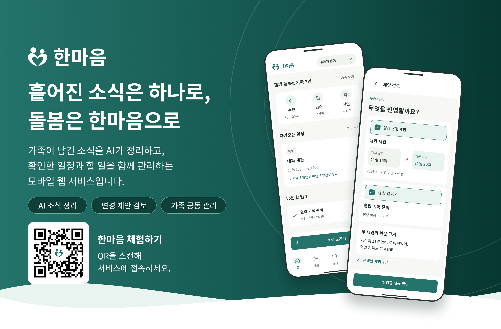
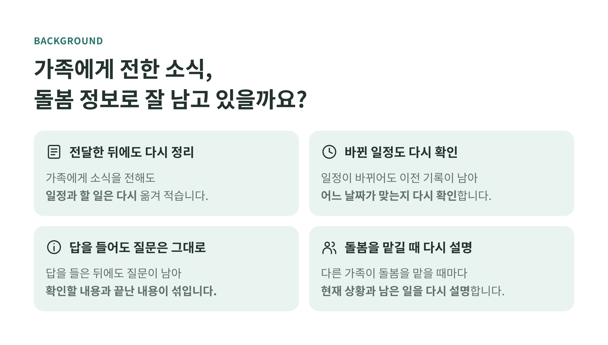
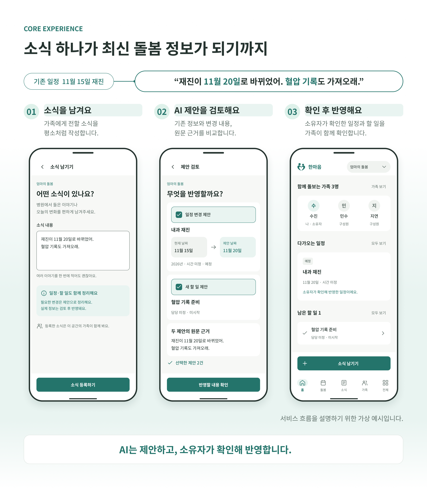
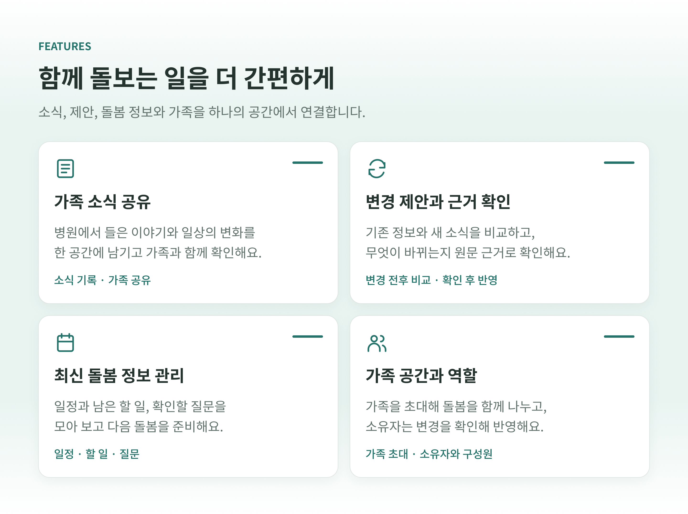
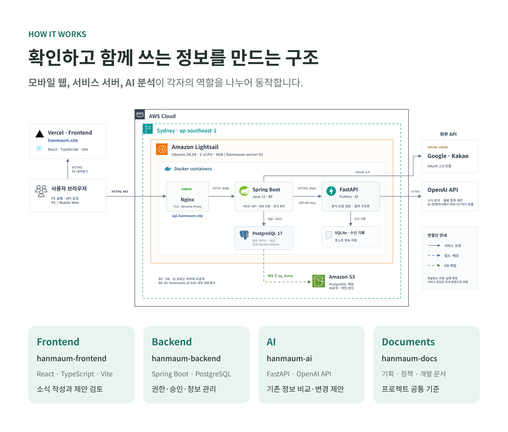
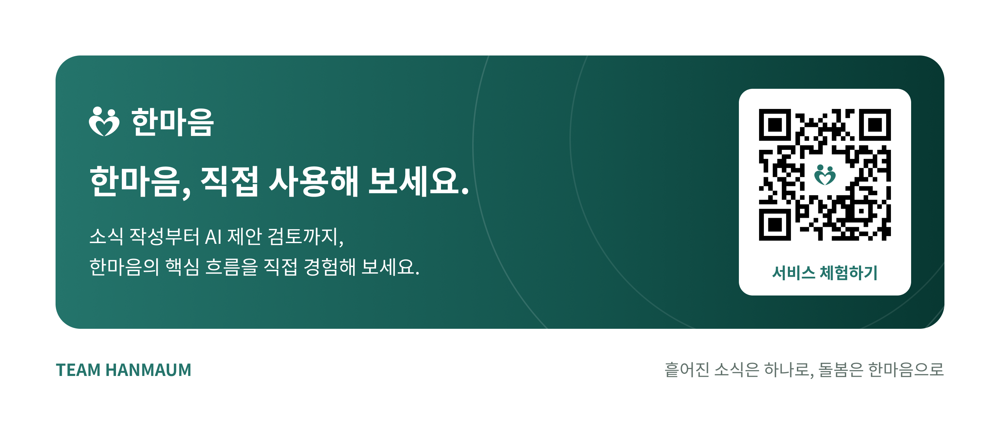

<!--
한마음 조직 소개. 디자인 이미지는 assets/, 팀 소개는 아래 HTML 표에서 관리합니다.
-->

   
   
   
   
   
  

## 함께 만드는 사람들

<table align="center">
  <thead>
    <tr>
      <th scope="col"></th>
      <th scope="col"></th>
      <th scope="col"></th>
      <th scope="col"></th>
    </tr>
  </thead>
  <tbody>
    <tr>
      <td align="center"><a href="https://github.com/stringnine"><strong>지현구</strong></a></td>
      <td align="center"><a href="https://github.com/BigSangHyeok"><strong>이상혁</strong></a></td>
      <td align="center"><a href="https://github.com/YouNoya"><strong>이윤호</strong></a></td>
      <td align="center"><a href="https://github.com/jenny2e"><strong>박주영</strong></a></td>
    </tr>
    <tr>
      <td align="center">팀장</td>
      <td align="center">팀원</td>
      <td align="center">팀원</td>
      <td align="center">팀원</td>
    </tr>
  </tbody>
</table>

<strong>흩어진 소식은 하나로, 돌봄은 한마음으로.</strong>

